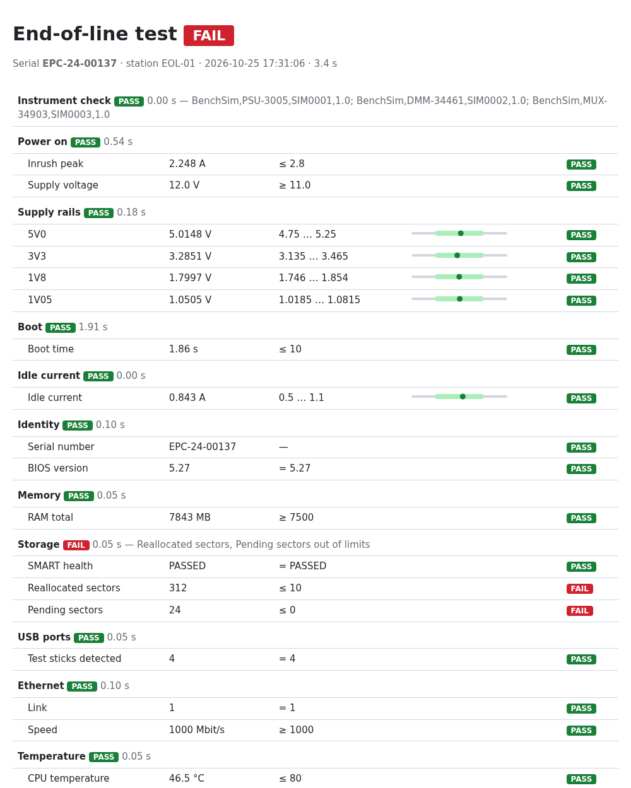

# bench-automation

An end-of-line test station for a 12 V embedded PC, written in Python —
complete with simulated instruments, so you can run the whole thing without a
single piece of hardware.

It does what a production test does: power the board up through a lab supply,
check inrush and idle current, measure every supply rail through a relay
multiplexer and a DMM, watch the serial console during boot, log in, and run
on-device checks (identity, RAM, SSD health, USB ports, Ethernet link, CPU
temperature, RTC). Every unit gets a pass/fail verdict and a report.



## Quick start

Needs Python 3.10+. The simulated instruments,
[scpi-sim](https://github.com/steitec/scpi-sim), come from PyPI.

```bash
python -m venv .venv && . .venv/bin/activate
pip install -e ".[dev]"

bench demo                 # healthy device -> PASS
bench demo --fault smart   # SSD with bad sectors -> FAIL in "Storage"
```

```
  [PASS ] Power on           Inrush peak 2.248 A, Supply voltage 12.0 V
  [PASS ] Supply rails       5V0 5.0148 V, 3V3 3.2851 V, 1V8 1.7997 V
  [PASS ] Boot               Boot time 1.86 s
  ...
  [FAIL ] Storage            Reallocated sectors, Pending sectors out of limits
  ...
  Result: FAIL  (EPC-24-00137, 3.4 s)
  Report: reports/EPC-24-00137_20261025-173106/report.html
```

Each run writes `result.json`, `measurements.csv` and a self-contained
`report.html` (with the full console log) to `reports/<serial>_<timestamp>/`.

## Injectable faults

The simulated device can be broken on purpose, to show that the test actually
catches real failure modes:

| `--fault` | Defect | Caught by |
|---|---|---|
| `short` | short circuit on the 12 V input | Power on — supply hits current limit, power is removed, rest skipped |
| `rail_1v05` | 1.05 V core rail missing | Supply rails |
| `boot_hang` | kernel hangs in a SATA reset loop | Boot — timeout, last console line in the report |
| `usb_port` | one dead USB port | USB ports |
| `smart` | SSD with reallocated/pending sectors | Storage |
| `no_link` | no Ethernet link | Ethernet |
| `overtemp` | CPU running hot | Temperature |

## Architecture

```
 bench run / bench demo
        │
  EndOfLineTest  ── limits & wiring from station.yaml
        │
  drivers.py ── PowerSupply, Multimeter, Multiplexer  (PyVISA, SCPI)
            └── SerialConsole                          (pyserial)
        │
  ┌─────┴──────────── simulator (bench simulate) ──────────────┐
  │ PSU :5025   DMM :5026   MUX :5027   console :5028           │
  │   scpi-sim instruments, wired to one EmbeddedPC device      │
  └─────────────────────────────────────────────────────────────┘
```

- The simulated instruments are [scpi-sim](https://github.com/steitec/scpi-sim):
  **SCPI over raw TCP sockets**, exactly like LAN instruments on port 5025 —
  short/long command forms, the SCPI path rule, error queue (`SYST:ERR?`) and
  status registers.
- The device under test, `EmbeddedPC` in
  [`src/bench/sim/dut.py`](src/bench/sim/dut.py), is a scpi-sim device: its
  12 V input is wired to the supply, its four rails to multiplexer channels
  101–104, its serial console is a TCP port like a terminal server
  (`socket://host:port`).
- The device model behaves physically: inrush current, constant-current limit
  pulling the supply voltage down on a short, boot timing, rails that only
  come up with sufficient input voltage. A running board loads the supply
  like a resistor, so a current limit below its demand pulls the input down
  (and below 10.8 V the board browns out). Closing two rail channels at once
  is refused (`-221`), as it would short the rails on a real fixture.

## Running on real hardware

Only the configuration changes. Point the resources in
[`station.yaml`](src/bench/station.yaml) at your instruments and pass it with
`--config`:

```yaml
visa_backend: ""                                   # NI-VISA / Keysight IO Libraries
resources:
  psu: "USB0::0x2A8D::0x1002::MY12345678::INSTR"
  dmm: "TCPIP0::192.168.1.20::INSTR"
  mux: "TCPIP0::192.168.1.21::5025::SOCKET"
  console: "/dev/ttyUSB0"
```

```bash
bench run --config my-station.yaml
```

The drivers use common SCPI commands (`VOLT`, `CURR`, `OUTP`, `MEAS:VOLT:DC?`,
`ROUT:CLOS (@101)`); instruments with different dialects need a small driver
subclass.

## Tests

```bash
pytest
```

The suite runs the full sequence against a healthy device and against every
injected fault, and checks that exactly the expected step fails.

## License

MIT
